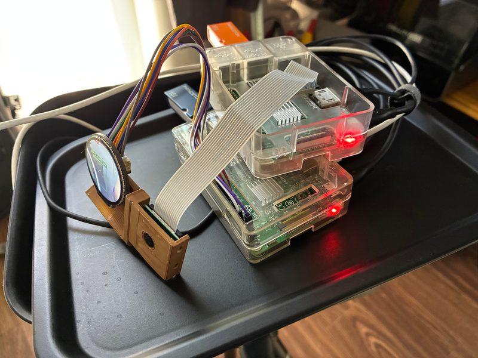
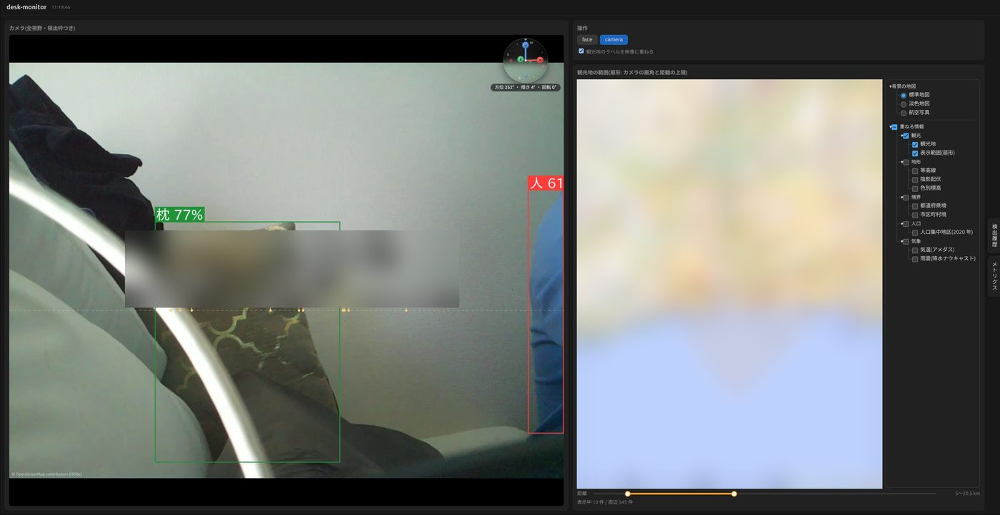
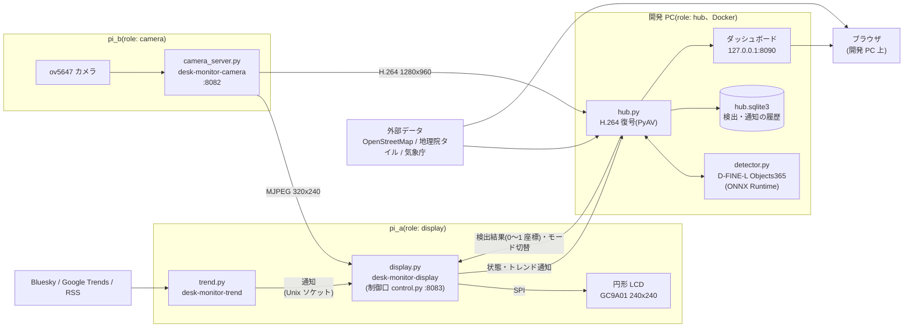

# desk-monitor

Raspberry Pi 2 台と開発 PC で動くデスクトップモニタ。カメラの映像を円形 LCD に映し、開発 PC で物体検出した結果を枠として重ねる。
構成の判断は [ADR-0001](docs/adr/0001-split-camera-display-and-inference-hub.md)。

## システム構成

- 機器間の接続(:8082 / :8083)は `wire.py` の形式で、共有トークンで認証し、プライベート IP 以外からの接続は拒否する。
  pi_a・ハブがそれぞれ接続しにいく側で、トークンと接続先は各機器の `~/.config/desk-monitor/desk-monitor.env` に置く
  (`scripts/setup-secrets.sh` で作って配る)
- ハブが止まっていても、pi_a は pi_b の映像を枠なしで LCD に出す
- トレンド監視の通知は LCD には出さず、表示プロセスがハブに中継してダッシュボードにトースト表示する
- ダッシュボードは開発 PC の 127.0.0.1 だけで待ち受ける。地図レイヤ(`layers.py`)と簡易 AR(`ar.py`)のデータは、
  ハブが外部から取得してキャッシュするものと、ブラウザが直接読むもの(地理院タイルなど)がある

| 機器 | role | サービス | 反映 |
|---|---|---|---|
| pi_a | display | `desk-monitor-display` / `desk-monitor-trend`(systemd ユーザーサービス) | `scripts/deploy.sh pi_a` |
| pi_b | camera | `desk-monitor-camera`(systemd ユーザーサービス) | `scripts/deploy.sh pi_b` |
| 開発 PC | hub | `hub`(`deploy/hub/compose.yaml`) | `scripts/deploy-hub.sh` |

## 持ち歩き用の観光 AR(試作)

`pwa/` は、固定設置の簡易 AR(`ar.py`)を iPhone などで持ち歩いて使えるようにした試作の PWA。
背面カメラの映像に、向けた方角にある観光地の名前と距離を重ねる。ハブや Pi は使わず、端末だけで動く。

- 公開先: `main` の `pwa/` を GitHub Pages に配置する(カメラとセンサーは HTTPS でしか使えない)
- 使い方: Safari で開いて「開始」を押し、カメラ・位置情報・動きと方向へのアクセスを許可する。共有メニューの「ホーム画面に追加」でアプリのように起動でき、一度開いたあとは保存済みの観光地で圏外でも動く
- 方位がずれていたら、映像を横にドラッグして遠くの山や建物にラベルを合わせる(補正は端末に保存される)
- 映像は端末の外に送らない。利用状況は端末内にだけ記録し、設定の「診断情報をコピー」で共有できる(位置は含まない)。詳しくは [利用規約](pwa/terms.html) と [プライバシーポリシー](pwa/privacy.html)
- テスト: `npm run test:pwa`
